<picture>
  <source media="(prefers-color-scheme: dark)" srcset="assets/banner-dark.svg">
  
</picture>

 

I'm a final-year Computer Science student who builds machine-learning systems people can trust: models that explain their verdicts, agents that cite their sources, and interfaces that keep a human in charge. I'm happiest where ML meets a real product and real users.

<a href="https://www.linkedin.com/in/dakshmehrotra"><picture><source media="(prefers-color-scheme: dark)" srcset="assets/btn-linkedin-dark.svg"></picture></a>

  

<picture><source media="(prefers-color-scheme: dark)" srcset="assets/sec-01-dark.svg">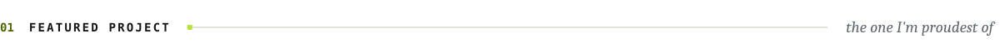</picture>

<a href="https://github.com/Dakshmehrotraa/opslens"><picture><source media="(prefers-color-scheme: dark)" srcset="assets/featured-opslens-dark.svg"></picture></a>

  

<picture><source media="(prefers-color-scheme: dark)" srcset="assets/sec-02-dark.svg">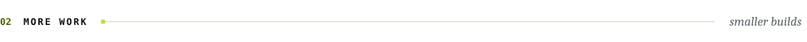</picture>

  <a href="https://github.com/Dakshmehrotraa/Prepagent"><picture><source media="(prefers-color-scheme: dark)" srcset="assets/card-prepagent-dark.svg">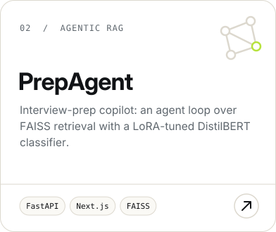</picture></a>
  <a href="https://github.com/Dakshmehrotraa/smart-paste"><picture><source media="(prefers-color-scheme: dark)" srcset="assets/card-smartpaste-dark.svg">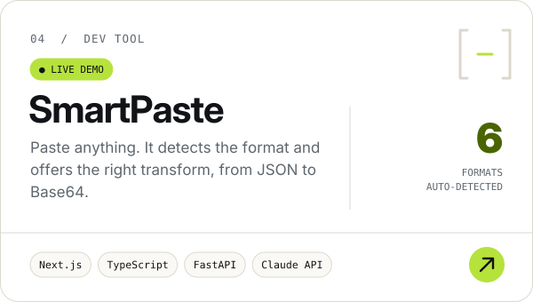</picture></a>
  <a href="https://github.com/Dakshmehrotraa/phishguard"><picture><source media="(prefers-color-scheme: dark)" srcset="assets/card-phishguard-dark.svg">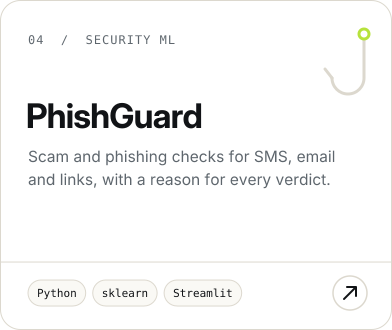</picture></a>

 

<picture><source media="(prefers-color-scheme: dark)" srcset="assets/sec-03-dark.svg">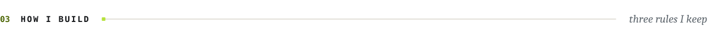</picture>

<picture><source media="(prefers-color-scheme: dark)" srcset="assets/principles-dark.svg">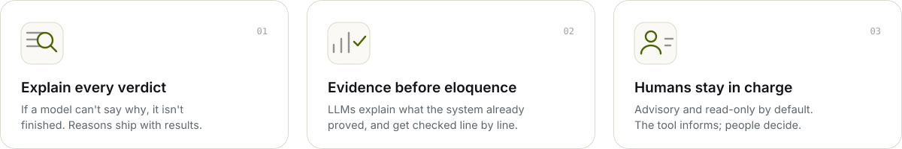</picture>

  

<picture><source media="(prefers-color-scheme: dark)" srcset="assets/sec-04-dark.svg">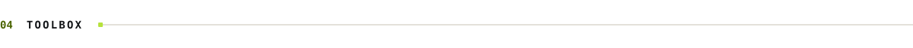</picture>

<picture>
  <source media="(prefers-color-scheme: dark)" srcset="assets/toolbox-dark.svg">
  
</picture>

  

<picture><source media="(prefers-color-scheme: dark)" srcset="assets/footer-dark.svg">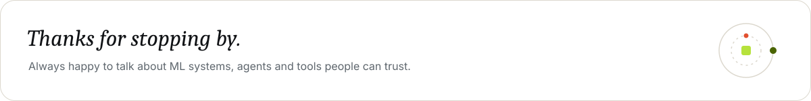</picture>
