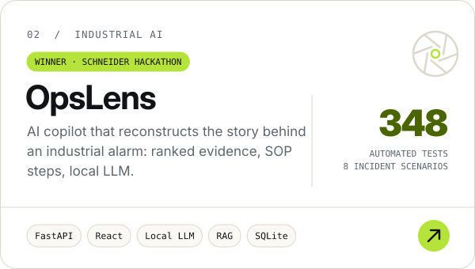
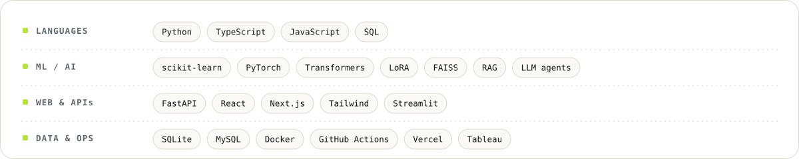

<picture>
  <source media="(prefers-color-scheme: dark)" srcset="assets/banner-dark.svg">
  
</picture>

  <a href="https://my-portfolio-mocha-nine-rx6jop46al.vercel.app/"><picture><source media="(prefers-color-scheme: dark)" srcset="assets/btn-portfolio-dark.svg"></picture></a>&nbsp;
  <a href="https://www.linkedin.com/in/dakshmehrotra"><picture><source media="(prefers-color-scheme: dark)" srcset="assets/btn-linkedin-dark.svg"></picture></a>&nbsp;
  <a href="https://ai-phishing-detector-app.streamlit.app"><picture><source media="(prefers-color-scheme: dark)" srcset="assets/btn-phishguard-dark.svg"></picture></a>

I'm a final-year Computer Science student who likes building machine-learning systems that people can actually trust. That means models that explain their verdicts, agents that cite their sources, and interfaces that keep a human in charge. Most of my work lives where ML meets a real product: a scam detector anyone can try in the browser, or a copilot for operators in a wastewater plant.

### Selected work

  <a href="https://github.com/Dakshmehrotraa/phishguard"><picture><source media="(prefers-color-scheme: dark)" srcset="assets/card-phishguard-dark.svg"></picture></a>
  <a href="https://github.com/Dakshmehrotraa/opslens"><picture><source media="(prefers-color-scheme: dark)" srcset="assets/card-opslens-dark.svg"></picture></a>
  <a href="https://github.com/Dakshmehrotraa/Prepagent"><picture><source media="(prefers-color-scheme: dark)" srcset="assets/card-prepagent-dark.svg"></picture></a>
  <a href="https://github.com/Dakshmehrotraa/smart-paste"><picture><source media="(prefers-color-scheme: dark)" srcset="assets/card-smartpaste-dark.svg"></picture></a>

### Toolbox

<picture>
  <source media="(prefers-color-scheme: dark)" srcset="assets/toolbox-dark.svg">
  
</picture>

### Lately

- **Won** the Schneider Electric HMI Hackathon (Innovation Marathon, SRM IST) with Team Sentient Screens for [OpsLens](https://github.com/Dakshmehrotraa/opslens).
- **Shipped** [PhishGuard](https://ai-phishing-detector-app.streamlit.app), my final-year project. It checks SMS, emails and links, and every verdict comes with its reasons.
- **Exploring** agent loops with retrieval, small fine-tuned models (LoRA), and keeping LLM output tied to real evidence.

If something here sounds interesting, say hi on <a href="https://www.linkedin.com/in/dakshmehrotra">LinkedIn</a>.
